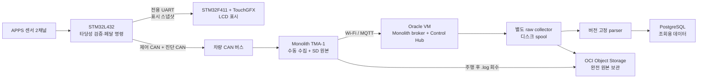

# Oracle Cloud Monolith 서버·파서·로거 운영 가이드

## 1. 이 프로젝트에서 권장하는 역할 분리

이 구성의 핵심은 안전 제어, 운전자 표시, 장기 로깅을 서로 의존하지 않게 만드는 것이다.



- L432는 APPS의 10 ms 안전 주기를 책임진다. 서버, Wi-Fi, F411이 죽어도 제어가 계속되어야 한다.
- F411은 L432가 확정한 상태를 표시한다. 화면 갱신 실패가 L432의 제어 결과를 바꾸면 안 된다.
- TMA-1은 CAN을 별도로 수집하고 자체 SD에 기록한다. 표시 UART를 로깅 경로로 재사용하지 않는다.
- Oracle 서버는 실시간 확인과 검색 가능한 사본을 제공한다. 주행의 최종 원본은 TMA-1의 SD 로그와 Object Storage 사본이다.

Monolith 공식 문서도 TMA-1과 Control Hub 사이에 MQTT 서버가 필요하고, Wi-Fi가 없어도 장치 자체 로깅은 계속된다고 설명한다.

## 2. 현재 저장소에서 실제로 준비된 부분

### L432 ↔ F411 표시 UART

현재 L432의 논리/물리 채널 대응은 다음과 같다.

| 용도 | 논리 채널 | 실제 주변장치 | 핀 | 송신 방식 |
|---|---|---|---|---|
| 개발용 CLI | `_DEF_UART1` | USART2 | PA2 TX, PA15 RX | blocking |
| F411 표시 | `_DEF_UART2` | USART1 | PA9 TX | TX DMA |

F411은 `_DEF_UART1`을 USART1 RX 전용 PA10으로 사용한다.

| L432 | F411 | 필수 여부 |
|---|---|---|
| PA9 / USART1_TX | PA10 / USART1_RX | 필수 |
| GND | GND | 필수 |

양쪽 모두 3.3 V 로직이며 두 보드의 GND를 반드시 공통으로 연결한다. L432에서 표시 데이터만 단방향으로 보낼 때도 GND와 `L432 TX → F411 RX`는 필요하다.

L432의 PA2는 service mode에서 CLI를 열 때만 USART2 TX로 전환된다. 현재 펌웨어는 service mode를 기본적으로 끄며 진입 호출자도 연결하지 않았으므로 정상 운전 부팅에서는 PA2를 점유하지 않는다. PCB에서 PA2를 GPIO로 써야 한다면 GPIO의 입력/출력과 안전 초기값을 확정해 별도로 초기화하고, 그 구성을 확정하기 전에는 `apSetServiceMode(true)`를 호출하지 않는다.

표시 UART 애플리케이션 계층은 현재 다음 범위까지 구현되어 있다.

1. L432 시작 시 `uartOpen(_DEF_UART2, 115200)` 호출
2. magic, version, sequence, APPS1/2, 최종 페달값, 상태/fault, CRC16을 포함한 34바이트 v1 패킷
3. 50 ms(20 Hz) 주기의 `uartWrite(_DEF_UART2, ...)` TX DMA 송신
4. F411 `_DEF_UART1` USART1 RX Circular DMA 수신과 프레이밍·CRC·sequence 검사
5. CRC 오류, 중복 sequence, 과거 sequence의 TouchGFX 값 갱신 차단
6. 정상 패킷이 300 ms 이상 없거나 RX DMA가 overrun되면 `DATA LOST` 표시
7. F411 USB CDC CLI의 `display info`로 수신값과 오류 카운터 확인

DMA를 MCU에 추가하는 정확한 절차는 `stm32l432kc/DMA_SETUP_CHECKLIST.md`에 정리되어 있다.

### 저장소 안의 기존 telemetry 코드

`stm32l432kc/src/ap/sw/telemetry/telemetry_decoder.c`는 Orion/Bamocar CAN 디코딩과 최신 신호 snapshot만 담당한다.

- `ap_runtime.c`는 `telemetryInit()`와 `telemetryUpdate()`를 호출하므로 CAN 수신·디코딩은 실행 중이다.
- L432 telemetry에는 FatFS/CSV 로거 및 SD 저장 경로가 없다.
- 디코딩된 값은 표시 UART 텔레메트리 패킷을 만드는 데 사용된다.

따라서 L432는 실시간 신호 디코딩만 담당하고, 영구 저장은 TMA-1/ESP와 Oracle 로거가 담당하는 현재 책임 분리를 유지한다.

## 3. CAN에 무엇을 기록할지

TMA-1은 L432와 F411 사이 UART를 보지 못하므로, APPS 판단 결과를 서버에 남기려면 L432가 별도의 진단 CAN 프레임을 발행해야 한다.

팀의 CAN ID 표에 충돌하지 않는 ID를 먼저 배정하고 다음 값을 10~20 Hz로 내보내는 것을 권장한다.

- APPS1 원시 ADC와 보정값
- APPS2 원시 ADC와 보정값
- 최종 페달 명령
- 타당성 상태와 현재 fault bit mask
- 누적 fault counter 또는 마지막 fault reason
- 8-bit rolling counter

진단 프레임은 제어 프레임 ID를 재사용하지 않는다. 주기 누락을 서버와 F411에서 구분할 수 있도록 rolling counter를 넣고, 필요하면 별도의 CRC를 넣는다. L432 제어 루프는 로깅 송신 실패를 기다리지 말고 해당 샘플만 버려야 한다.

TMA-1을 물리적 CAN 버스의 끝에 놓을 때만 보드의 120 Ω 종단 점퍼를 켠다. 전원을 끈 상태에서 CANH-CANL을 측정했을 때 정상적인 양 끝 종단 구성은 약 60 Ω이다.

Monolith에는 원격 CAN 송신 기능도 있다. 이 차량에서 TMA-1을 수집 전용으로 쓸 경우, 운전 상태에서는 원격 CAN 송신을 펌웨어/정책으로 막고 Control Hub의 Console 송신을 사용하지 않는 것이 안전하다.

## 4. 기본 Monolith 서버만으로 영구 로깅이 되지 않는 이유

공식 서버 구성은 MQTT 중계, WebSocket/HTTP 프록시, Control Hub 제공에 초점이 있다. v2.3.1의 기본 Compose에는 장기 보관용 데이터베이스가 없고, Control Hub의 CAN decoder도 브라우저 쪽 설정이다. Mosquitto의 broker 상태와 retained message는 volume에 영속화될 수 있지만, 이것은 검색·재처리 가능한 주행 이력 DB가 아니다.

또한 기본 구성의 원격 파일 임시 영역은 cleanup 서비스가 정리한다. 따라서 서버에 잠시 업로드된 `.log` 파일을 영구 백업으로 간주하면 안 된다.

실시간 telemetry/CAN/syslog 경로(`/d`, `/d/can`, `/d/sl`)는 v2.3.1 구현에서 QoS 0을 사용한다. VM, 네트워크 또는 collector가 끊긴 동안의 실시간 메시지는 나중에 자동 복구되지 않는다. collector가 QoS 1로 구독해도 발행측 QoS 0의 전달 보장을 높일 수 없다. 그러므로 다음 두 경로를 같이 유지한다.

1. **실시간 경로:** MQTT raw collector → 로컬 spool → parser → PostgreSQL
2. **완전 원본 경로:** TMA-1 SD `.log` → 주행 후 회수 → OCI Object Storage

## 5. Oracle Cloud 권장 배치

한 팀이 운영하는 초기 구성은 VM 한 대와 별도 Block Volume 한 개로 충분하다.

- OS: Ubuntu LTS 권장. 공식 Monolith 설치 예제가 `apt` 기준이다.
- VM: 시작점으로 2 OCPU, RAM 4~8 GB. 실제 CAN 빈도와 보존 기간을 보고 조정한다.
- 시스템 디스크: OS와 Docker Engine
- Block Volume: `/srv/monolith`에 마운트하여 DB, raw spool, 백업 staging 저장
- Object Storage: SD 원본, 일별 raw 압축본, DB 백업 저장
- Domain: `monolith.example.org` 같은 전용 FQDN과 공인 DNS A/AAAA 레코드

Always Free 자원은 장기 무활동 시 회수 가능성이 있으므로 대회 운영에 필요한 가용성을 무료 자원 하나에만 의존하지 않는다. ARM Ampere 인스턴스를 선택하면 Monolith가 사용하는 모든 컨테이너 이미지가 arm64를 제공하는지 먼저 시험한다.

### NSG 또는 Security List

| 포트 | 소스 | 용도 |
|---:|---|---|
| TCP 443 | 필요한 인터넷 범위 | HTTPS/WSS Control Hub와 MQTT proxy |
| TCP 80 | 현재 TMA 원격 로그 upload/download를 쓸 범위 | v2.3.1 파일 전달 경로가 HTTP이므로 닫기 전 실제 동작 확인 |
| TCP 22 | 팀의 고정 공인 IP/CIDR | SSH 관리 |

`1883`, `9001`, `9003`, `5432`는 인터넷에 공개하지 않는다. PostgreSQL은 Docker 내부 network에서만 접근하게 한다. OCI NSG를 1차 방화벽으로 사용하고, Docker가 publish한 포트는 일반 UFW 규칙을 우회할 수 있음을 고려한다.

v2.3.1의 원격 로그 파일 URL과 upload router는 HTTP 80을 사용한다. 민감한 주행 로그를 인터넷으로 전달한다면 HTTPS upload로 바꾼 fork를 만들고 TMA-1 호환성을 검증해야 한다. 그 전까지는 80번 경로가 평문임을 전제로 접근 범위와 데이터 민감도를 결정한다. ACME 설정은 TLS challenge를 사용하므로 80번을 인증서 발급 때문에 열어 두는 구성으로 오해하지 않는다.

## 6. Monolith v2.3.1 설치 순서

현재 기준으로 검증할 기준 버전은 `v2.3.1`이다. `main`이나 `latest`를 무조건 따라가지 말고 tag 또는 commit을 고정한다. upstream Compose 안에도 `nginx:latest`, `busybox:latest` 같은 가변 image가 있으므로 재현성이 중요한 운영 override에서는 시험한 image tag 또는 digest까지 고정한다.

### 6.1 사전 준비

1. Oracle VM에 Docker Engine, Docker Compose plugin, Git, Node.js를 설치한다.
2. 데이터용 Block Volume을 `/srv/monolith`에 마운트하고 재부팅 후에도 올라오도록 `/etc/fstab`을 설정한다.
3. 다음 디렉터리를 만든다.

```text
/srv/monolith/postgres
/srv/monolith/spool
/srv/monolith/raw-archive
/srv/monolith/backup
```

4. DNS가 VM 공인 IP를 가리키는지 확인한다.
5. 서버 시간 동기화가 활성화되어 있는지 확인한다.

### 6.2 소스 고정과 Web 빌드

`<ADMIN_USER>`와 `<ADMIN_GROUP>`은 실제 운영 계정으로 바꾼다.

```bash
sudo install -d -o <ADMIN_USER> -g <ADMIN_GROUP> -m 0750 /opt/monolith
git clone --branch v2.3.1 --depth 1 https://github.com/luftaquila/monolith.git /opt/monolith
cd /opt/monolith/web
npm install
npm run build
```

공식 문서는 `web`을 먼저 빌드한 뒤 `server`에서 Compose를 실행하는 순서를 사용한다.

### 6.3 채널 자격 증명과 환경 파일

```bash
sudo apt install -y mosquitto
cd /opt/monolith/server/config
mosquitto_passwd -c mosquitto.passwd <CHANNEL_NAME>
chmod 600 mosquitto.passwd

cd /opt/monolith/server
cp .env.example .env
chmod 600 .env
```

`.env`에서 최소한 `ACME_EMAIL`, `DOMAIN_NAME`을 설정하고, announcement 등 선택값을 검토한다. 채널 key, DB password, Object Storage 관련 비밀은 Git에 넣지 않는다.

Mosquitto ACL은 채널 이름을 topic prefix로 사용하므로 TMA-1, Control Hub, collector가 같은 channel name/key를 쓰도록 한다. collector의 MQTT client ID는 장치와 겹치지 않게 별도로 만든다. 기본 `%u/#` ACL은 같은 계정에 read와 write를 모두 줄 수 있으므로 collector를 진짜 read-only로 만들려면 별도 계정만 추가하는 것으로 끝내지 말고, 해당 채널을 읽도록 ACL을 명시적으로 분리해 시험한다.

### 6.4 Compose 시작 전 검사

v2.3.1 Compose는 외부 `traefik` network와 `with_traefik` profile을 사용한다. 현재 `.env.example`에는 `COMPOSE_PROFILES=with_traefik`가 들어 있지만 복사·수정된 실제 `.env`도 profile을 활성화하는지 먼저 출력으로 확인한다.

```bash
cd /opt/monolith/server
docker compose config
docker compose config --profiles
docker compose config --services
docker network inspect traefik >/dev/null 2>&1 || docker network create traefik
```

서비스 목록에 Traefik이 없다면 profile을 명시한다.

```bash
docker compose --profile with_traefik up -d
docker compose ps
docker compose logs --tail 100
```

`.env`가 이미 profile을 활성화한다면 공식 문서처럼 `docker compose up -d`를 사용해도 된다. 시작 명령을 systemd와 운영 문서에서 하나로 통일한다.

### 6.5 v2.3.1 DNS resolver 주의사항

v2.3.1의 Nginx와 HAProxy 설정에는 `10.89.0.1` resolver가 들어 있다. 이 값은 흔히 Podman 계열 network에서 보이며, 표준 Docker embedded DNS는 보통 `127.0.0.11`이다. 공식 문서는 Docker를 안내하므로 배포 직후 반드시 현재 컨테이너의 값을 확인한다.

```bash
docker compose exec nginx cat /etc/resolv.conf
docker compose logs nginx
docker compose logs haproxy
```

upstream service 이름 해석 오류가 보일 때만 fork한 설정에서 resolver를 실제 컨테이너 DNS 주소로 맞춘다. Docker에서 확인값이 `127.0.0.11`이라면 Nginx의 `resolver`와 HAProxy `nameserver`도 그 값/53번 포트로 조정한다. 수정본은 별도 override/config 파일로 버전 관리하고 upstream tag를 올릴 때 다시 diff한다.

### 6.6 외부 동작 확인

```bash
curl -fsS https://<DOMAIN_NAME>/ >/dev/null
docker compose ps
docker compose logs --since 10m --tail 200
```

그 다음 브라우저 Control Hub와 TMA-1에 같은 server address/channel name/key를 넣는다. Live Telemetry가 보이는지, TMA-1 SD에는 Wi-Fi를 끊어도 로그가 계속 쌓이는지 각각 확인한다.

## 7. 별도 collector·parser·DB 설계

### 7.1 collector 원칙

MQTT callback 안에서 JSON 변환이나 DB insert를 직접 하지 않는다.

1. 수신 시각, topic, qos, retain flag, payload bytes를 append-only spool에 먼저 기록한다.
2. `fsync` 정책에 따라 원본이 안전하게 기록된 뒤 callback을 빨리 반환한다.
3. 별도 worker가 spool을 읽어 파싱하고 DB에 batch insert한다.
4. DB가 멈추면 spool만 계속 늘고, DB 복구 뒤 checkpoint부터 replay한다.
5. parse 오류가 나도 raw record를 삭제하지 않는다.

spool record에는 최소 다음 값을 남긴다.

```text
record_id
received_at_utc
channel/device
topic
qos/retain
payload_length
payload_bytes
monolith_release
parser_version
parse_status/parse_error
```

### 7.2 parser 원칙

- parser는 Monolith release/tag와 함께 버전 고정한다.
- `/d` telemetry payload는 v2.3.1 기준 길이와 magic/type/checksum을 확인한 뒤 읽는다.
- `/d/can`, `/d/sl`처럼 여러 record를 묶는 topic은 전체 길이가 해당 record 크기의 배수인지 먼저 확인한다.
- retained `/d/boot`는 정상 연결 시 binary boot epoch이지만 LWT에서는 같은 topic에 ASCII `OFFLINE`이 올 수 있으므로 길이와 내용을 먼저 구분한다.
- 정수는 반드시 명시된 endian과 signedness로 읽고 구조체를 바로 cast하지 않는다.
- 장치 uptime은 32-bit ms wrap을 고려한다. 서버 수신 시각과 retained boot epoch/firmware 정보를 함께 보존한다.
- CAN decoder 설정이 바뀌어도 과거 raw CAN은 다시 해석할 수 있게 raw frame을 먼저 저장한다.

### 7.3 권장 DB 테이블

| 테이블 | 핵심 내용 |
|---|---|
| `devices` | channel, device, firmware, 등록 정보 |
| `sessions` | boot/run 시작·종료, 차량, driver, parser version |
| `raw_messages` | topic과 원본 payload, parse 상태 |
| `samples` | GPS/analog/digital/IMU 등 기본 telemetry |
| `can_frames` | session, timestamp, CAN ID, flags, DLC, data[8] |
| `events` | syslog, user event, fault event |

큰 테이블은 날짜 또는 session 기준으로 partition하고, `timestamp`, `(session_id, can_id, timestamp)`에 index를 둔다. 처음부터 모든 신호를 넓은 열로 만들기보다는 raw CAN과 parser version을 보존해 decoder 변경 시 재처리 가능하게 한다.

### 7.4 용량 산정

압축·DB/WAL/index를 제외한 대략적인 raw payload 양은 다음 식으로 먼저 계산할 수 있다.

```text
bytes/day ≈ 86400 × [104 × (1000 / telemetry_interval_ms)
                     + 24 × CAN_frames_per_second
                     + 24 × syslog_records_per_second]
```

기본 telemetry만 10 ms이면 약 0.9 GB/day, 100 ms이면 약 90 MB/day 수준이다. 실제 디스크는 PostgreSQL row overhead, index, WAL, spool, 백업 때문에 raw 계산의 2~4배를 잡고 실측 후 보존 기간을 정한다.

## 8. 서비스 자동 시작

Compose의 `restart: unless-stopped`만으로 Docker daemon 시작 전후 순서와 운영 명령을 명확히 관리하기 어려우므로 systemd oneshot unit으로 전체 stack을 감싼다.

```ini
[Unit]
Description=Monolith telemetry stack
Requires=docker.service
After=docker.service network-online.target
Wants=network-online.target

[Service]
Type=oneshot
RemainAfterExit=yes
WorkingDirectory=/opt/monolith/server
ExecStart=/usr/bin/docker compose -f docker-compose.yml -f compose.production.yaml up -d --remove-orphans
ExecStop=/usr/bin/docker compose -f docker-compose.yml -f compose.production.yaml stop
TimeoutStartSec=0

[Install]
WantedBy=multi-user.target
```

Traefik profile이 필요한 구성이라면 `ExecStart`/`ExecStop`에도 동일한 `--profile with_traefik`을 넣는다. 데이터 volume을 지울 수 있는 `down -v`를 운영 종료 명령으로 사용하지 않는다.

## 9. 백업과 보존

### 매일

- PostgreSQL logical backup(`pg_dump` 또는 pgBackRest)을 만든다.
- 완료된 raw spool segment를 압축하고 checksum을 만든다.
- DB backup과 raw archive를 private OCI Object Storage bucket으로 복사한다.
- 성공한 object의 checksum/size를 확인한 뒤에만 로컬 보존 정책을 적용한다.

### 주행 후

- TMA-1의 `.log` 파일을 원본 그대로 Object Storage에 업로드한다.
- 파일명에 UTC session 시작 시각, 차량, device, firmware를 연결하는 manifest를 남긴다.
- 서버 raw와 SD log의 시간 범위·CAN frame count를 비교해 실시간 손실률을 기록한다.

### Oracle 설정

- `/srv/monolith` Block Volume에 자동 backup policy를 연결한다.
- Object Storage lifecycle로 예를 들어 `Standard → Archive → 삭제` 단계를 보존 규정에 맞춰 설정한다.
- bucket은 public access를 금지한다.
- VM에는 user API key를 복사하지 말고 OCI instance principal/dynamic group policy를 사용한다.
- 최소 월 1회 새 VM/새 DB에 실제 restore 테스트를 하고 시간을 기록한다.

Block Volume snapshot 하나만으로 PostgreSQL의 논리 일관성과 장기 원본 보존을 모두 대신하지 않는다.

## 10. 모니터링과 알람

OCI Agent의 기본 compute metric에 다음 application metric을 추가한다.

- `mqtt_connected`
- `last_message_age_seconds`
- `spool_pending_bytes`
- `parse_error_total`
- `db_queue_depth`
- `db_write_failure_total`
- `disk_free_percent`
- `last_backup_age_seconds`

최소 알람은 다음과 같이 둔다.

- 운전/시험 시간에 `last_message_age_seconds`가 임계값 초과
- collector MQTT 연결 끊김
- spool이 계속 증가하고 DB 반영량이 0
- `/srv/monolith` 여유 공간 부족
- backup age가 26시간 초과
- TLS 인증서 만료 임박

알람은 OCI Notifications를 통해 팀 메일/메신저로 전달한다. 외부 HTTPS health check는 Control Hub가 뜨는지만 보므로 collector와 DB용 내부 health endpoint도 별도로 둔다.

## 11. 단계별 검증 계획

### A. 책상 위 UART 시험

1. L432 USART1 TX와 F411 USART1 RX, GND만 연결한다.
2. 20 Hz 고정 패킷의 증가 sequence와 CRC가 정상인지 확인한다.
3. logic analyzer로 115200 8-N-1과 프레임 간격을 확인한다.
4. L432 APPS 10 ms loop 주기 min/max를 측정해 DMA 송신 전후 jitter를 비교한다.
5. F411 전원을 껐다 켜고 L432 제어 루프가 영향을 받지 않는지 확인한다.
6. 케이블을 뽑았을 때 F411이 timeout 후 `DATA LOST`를 표시하는지 확인한다.

### B. CAN/TMA-1 시험

1. 차량 전원을 끄고 CANH-CANL 약 60 Ω을 확인한다.
2. CAN analyzer로 새 진단 ID의 주기, DLC, rolling counter를 확인한다.
3. TMA-1 SD와 Live Telemetry에서 같은 frame count가 보이는지 확인한다.
4. Wi-Fi를 5분 끊어 SD는 계속 기록되고 live collector에는 실제 gap이 남는지 확인한다.
5. Wi-Fi 복구 후 MQTT와 Control Hub가 자동 재연결되는지 확인한다.

### C. Oracle 장애 시험

1. collector만 중지하고 broker/Control Hub가 계속 동작하는지 확인한다.
2. PostgreSQL만 중지하고 raw spool이 증가하는지 확인한다.
3. DB 복구 후 중복 없이 replay되는지 확인한다.
4. VM 재부팅 후 Monolith, collector, parser, DB가 자동 시작하는지 확인한다.
5. 디스크를 경고 임계값까지 채운 staging 환경에서 알람과 보호 동작을 확인한다.
6. 손상된 길이/checksum payload를 주입해 parser가 죽지 않고 raw+error를 보존하는지 확인한다.
7. Object Storage의 DB backup과 SD `.log`를 새 환경에 복원한다.

### D. 주행 승인 기준

- APPS 10 ms deadline miss 없음
- F411/서버/TMA-1 고장이 L432 안전 판단에 영향 없음
- UART CRC 오류·sequence gap counter가 확인 가능함
- CAN bus load가 팀 제한 이내임
- SD 원본과 서버 사본의 시간 기준이 맞음
- 백업 복원 절차를 다른 팀원이 문서만 보고 성공함

## 12. 업데이트 절차

1. 현재 tag, Compose config, custom parser version을 기록한다.
2. 새 Monolith release의 firmware payload/ACL/proxy/cleanup 변경을 diff한다.
3. staging VM에서 SD log replay와 live device 시험을 수행한다.
4. DB migration 전 backup과 restore test를 완료한다.
5. 운영 반영 후 telemetry, CAN, upload, parser, backup을 모두 확인한다.
6. 문제가 있으면 이미지와 source tag를 이전 고정 버전으로 되돌린다. 데이터 volume은 삭제하지 않는다.

## 참고 자료

- [Monolith v2 한국어 문서](https://v2.monolith.luftaquila.io/docs/ko.html)
- [Monolith v2.3.1 release](https://github.com/luftaquila/monolith/releases/tag/v2.3.1)
- [v2.3.1 Docker Compose](https://raw.githubusercontent.com/luftaquila/monolith/v2.3.1/server/docker-compose.yml)
- [v2.3.1 Nginx 설정](https://raw.githubusercontent.com/luftaquila/monolith/v2.3.1/server/config/nginx.conf)
- [v2.3.1 HAProxy 설정](https://raw.githubusercontent.com/luftaquila/monolith/v2.3.1/server/config/mqtt-proxy.cfg)
- [OCI Block Volume backup policy](https://docs.oracle.com/en-us/iaas/Content/Block/Tasks/schedulingvolumebackups.htm)
- [OCI Object Storage lifecycle policy](https://docs.oracle.com/en-us/iaas/Content/Object/Tasks/usinglifecyclepolicies.htm)
- [OCI Monitoring 개요](https://docs.oracle.com/en-us/iaas/Content/Monitoring/Concepts/monitoringoverview.htm)
