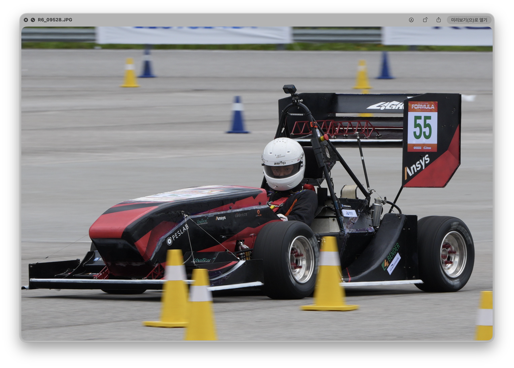
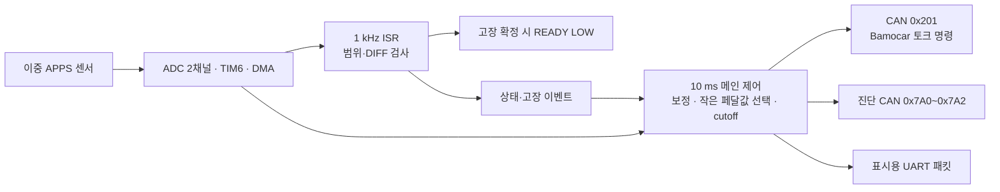

# LIGHT-ON APPS

### 이중 페달 센서 검증부터 CAN 토크 명령까지

LIGHT-ON 차량의 가속 페달 입력을 읽고, 두 센서의 타당성을 검증해 Bamocar D3 인버터에 토크 명령을 전달하는 **STM32L432KC 기반 제어 펌웨어**입니다. 센서 고장 판단은 1 kHz ADC 인터럽트에서, 토크 명령과 진단 통신은 메인 루프에서 처리합니다.

*LIGHT-ON 차량 주행 사진. 이 저장소는 차량 시스템 중 APPS 입력 처리와 토크 명령·진단 통신을 다룹니다.*

`C` · `STM32L432KC` · `STM32 HAL` · `ADC / DMA / TIM6` · `CAN 500 kbit/s`

## 프로젝트에서 해결하는 문제

가속 페달의 두 센서는 같은 위치에서도 서로 다른 ADC 값을 출력합니다. 각 채널을 같은 단위로 보정하고, 범위 이탈과 채널 간 불일치를 구분한 뒤 유효한 입력만 토크 명령으로 연결해야 합니다. 동시에 CAN 송신과 진단 출력이 센서 고장 검사를 지연시키지 않도록 실행 경로를 나눴습니다.

| 구현 영역 | 처리 방식 |
| --- | --- |
| 센서 입력 | TIM6 트리거, 12-bit ADC 2채널, circular DMA, 1 kHz 샘플링 |
| 입력 보정 | 채널별 release/full raw를 0~1000 per-mille로 환산 |
| 페달 선택 | 보정된 두 채널 중 작은 값을 최종 페달로 사용 |
| 고장 판정 | DIFF는 연속 100샘플, RANGE·ADC 읽기 이상은 지연 판정 없이 처리 |
| 출력 | 10 ms 주기로 signed 16-bit CAN 토크 명령 생성 |
| 진단 | CLI, APPS 진단 CAN 3프레임, 표시용 UART 패킷 |

## 데이터 흐름

현재 DISPLAY 저장소의 계기판은 **차량 CAN을 직접 수신**합니다. APPS에 구현된 UART 송신은 이전 표시 링크와의 호환 경로로 구분합니다. 외부 TMA-1 로거와 서버 수집기는 제어 경로와 별도로 진단·차량 데이터를 기록합니다.

## 핵심 설계

### 1. 센서별 보정과 고장 범위를 분리

페달 0%·100%를 정하는 보정 범위와 전기적 이상을 판단하는 유효 raw 범위를 따로 관리합니다. 보정 결과는 0~1000으로 제한하며, 두 채널 차이가 `100 per-mille`, 즉 **10%p 이상**이면 DIFF 판정을 시작합니다.

현재 기본값은 [apps.h](stm32l432kc/src/ap/sw/apps/apps.h)에 있습니다.

| 항목 | APPS1 | APPS2 |
| --- | ---: | ---: |
| 페달 0% raw | 610 | 458 |
| 페달 100% raw | 3700 | 2812 |
| 유효 raw 범위 | 200~4050 | 200~4050 |

이 값은 현재 펌웨어 설정이며 다른 센서·보드에 그대로 적용하는 범용 보정값은 아닙니다.

### 2. 고장 감지와 통신을 서로 다른 실행 경로에 배치

DIFF는 1 kHz ADC 콜백에서 연속 샘플을 셉니다. 100번째 이상 샘플에서 고장을 확정하고 READY를 LOW로 내립니다. RANGE 이상은 첫 검출 샘플에서 처리하며, ADC 갱신 정지는 메인 루프에서 sequence와 경과 시간으로 추가 감시합니다.

| 조건 | 펌웨어 동작 |
| --- | --- |
| 정상 입력 | 페달 기반 토크 명령 |
| DIFF 연속 1~99샘플 | pending, 페달 명령 유지 |
| DIFF 연속 100샘플 | ISR에서 고장 확정, READY LOW |
| 유효 raw 범위 이탈 | ISR에서 고장 처리, READY LOW |
| ADC 읽기 실패·갱신 정지 | ADC fault, 출력 금지 |
| 확정 고장 처리 후 모든 APPS 이상 해소 | 정상 명령 재개 가능 |

ISR에서는 CAN 전송을 호출하지 않습니다. 현재 기본 빌드인 `_DEF_VER2`는 다음 제어 실행에서 토크 0을 송신합니다. `_DEF_VER1`은 무효 입력에서 CAN 채널을 닫고 송신을 중지하는 별도 분기입니다.

ISR의 확정 고장 이벤트는 메인에서 소비할 때까지 보존하며, 송신 준비 뒤에도 출력 금지 플래그를 다시 확인합니다. 고장 여부는 별도 bool 대신 `fault_latched_status != APPS_STATUS_OK`로 판단합니다.

### 3. 토크 크기 계산과 방향 부호 적용을 분리

페달 환산과 cutoff는 양수 크기에서 처리하고 CAN 송신 직전에 방향 부호를 적용합니다. 현재 `APPS_TORQUE_COMMAND_SIGN = -1`이므로 페달 100%의 전송값은 `-32767`입니다.

- 하단 cutoff: 명령 크기 `1500` 이하를 0으로 처리합니다.
- 상단 cutoff: `32767` 이상을 최대값으로 처리합니다. 현재 값에서는 98% 조기 포화 동작이 없습니다.
- CAN 형식: standard ID `0x201`, DLC `3`, `{0x90, LSB, MSB}`.

### 4. 제어 상태를 외부에서 관찰할 수 있도록 구성

APPS 진단 CAN은 50 ms마다 raw·보정값·명령·고장 상태를 `0x7A0`, `0x7A1`, `0x7A2`로 전송합니다. 세 프레임은 같은 rolling counter를 사용합니다. 프레임 정의는 [apps_diag_can.h](shared/apps_diag_can.h), 신호 해석용 DBC는 [apps_diag_can.dbc](shared/apps_diag_can.dbc)에 있습니다.

## 코드 구성

| 경로 | 역할 |
| --- | --- |
| [ap.c](stm32l432kc/src/ap/ap.c) | 초기화·메인 루프·CLI 진입점 |
| [ap_runtime.c](stm32l432kc/src/ap/ap_runtime.c) | 10 ms 제어, UART·진단 CAN·Bamocar 요청 스케줄링 |
| [apps.c](stm32l432kc/src/ap/sw/apps/apps.c) | 보정·고장 정책·토크 생성·진단 CLI |
| [adc.c](stm32l432kc/src/hw/driver/adc.c) | TIM6 트리거·ADC DMA·완료 콜백 |
| [bamocar_can.c](stm32l432kc/src/ap/sw/bamocar/bamocar_can.c) | 레지스터 요청·토크 프레임 생성과 송신 |
| [telemetry.c](stm32l432kc/src/ap/sw/telemetry/telemetry.c) | 차량 CAN 신호 디코딩 |
| `shared/` | 표시 패킷·진단 CAN 정의와 호스트 테스트 소스 |
| `tools/` | Monolith 패치, 서버 수집기, 데이터 다운로드 도구 |

## 빌드와 확인

1. STM32CubeIDE에서 `stm32l432kc`의 기존 프로젝트를 가져옵니다.
2. 현재 기본 버전은 `src/common/def.h`의 `_DEF_VER2`입니다. 대상 하드웨어와 보정값을 확인한 뒤 빌드합니다.
3. ST-Link/SWD로 빌드 산출물을 기록합니다.
4. CLI는 USART2, `57600 baud / 8-N-1 / flow control none`입니다. 현재 `apInit()`은 CLI를 직접 엽니다.
5. `apps status`, `apps config`로 설정·상태를 확인하고 USB-CAN에서 `0x201`과 진단 프레임을 확인합니다.

`src/lib/cube_l432/Core`의 CubeMX 생성 코드는 실제 활성 드라이버와 구분해야 합니다. 주변장치 설정을 변경할 때는 [DMA 설정 체크리스트](stm32l432kc/DMA_SETUP_CHECKLIST.md)의 활성 소스·IRQ 경로를 함께 확인합니다.

## 검증 범위와 남은 확인

이 README의 주기·임계값은 현재 소스 기준입니다. **100샘플 고장 판정과 실제 구동 토크 차단 시간은 구분**합니다. 물리 고장 발생부터 READY LOW, CAN 0 수신, 인버터 반응까지의 시간은 별도 계측이 필요합니다. 전체 지연 실측값이나 인증 결과는 이 문서에서 주장하지 않습니다.

단선 검출은 입력이 실제로 유효 raw 범위를 벗어나는지에 달려 있습니다. 부동 입력이 정상 범위에 남는 경우를 소프트웨어만으로 식별할 수는 없으므로 보드의 입력 바이어스와 실측을 함께 확인해야 합니다. 현재 CLI에는 반복 출력 명령이 있으므로 실행 중 제어 주기 지연도 확인 대상입니다.

## 상세 문서

- [현재 펌웨어 설정·고장 정책·CLI](stm32l432kc/README.md)
- [STM32L432 DMA 설정 체크리스트](stm32l432kc/DMA_SETUP_CHECKLIST.md)
- [Monolith 구축 기록](MONOLITH_DEPLOYMENT.md)
- [Oracle Cloud 서버·파서·로거 운영 가이드](ORACLE_MONOLITH_LOGGER.md)
- [TEM 45채널 데이터 파이프라인 변경](TEM_45CH_DATA_PIPELINE_CHANGE.md)
- [개편 전 최상위 README 원본](README.before-portfolio-2026-11-14.md)

STM32 HAL과 기반 드라이버, Monolith 기반 구성은 각 원본 프로젝트의 영역입니다. 이 README는 저장소의 구현을 설명하며, 차량 전체 제작이나 제3자 라이브러리 개발을 개인 기여로 표현하지 않습니다.
