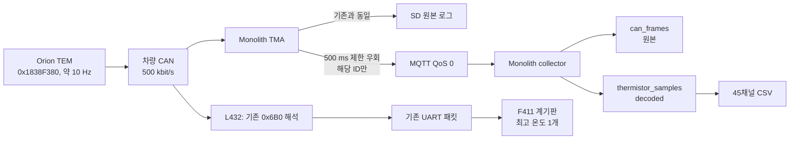

# Orion TEM 45채널 서버 수집 변경서

## 문서 정보

| 항목 | 내용 |
|---|---|
| 상태 | 구현 완료 / 운영 미배포 |
| 작성일 | 2026-08-13 KST |
| 목적 | Orion TEM 45개 온도를 Monolith 서버에서 조회하고 CSV로 내보내기 |
| TMA 기준 | Monolith v2.3.0, `d9067e9f2e4a6007b0157af1ced1846690d077b0` |
| 계기판 결정 | 기존 `0x6B0` 최고 온도 1개 표시 유지 |
| 승인자 | [ ] |
| 운영 배포일 | [ ] |
| 실차 검증일 | [ ] |

> 이 문서의 코드는 저장소에 준비했지만 운영 VM, 운영 DB, TMA 및 차량 MCU에는
> 아직 배포하거나 플래시하지 않았다.

## 1. 결정 요약

이번 변경은 **서버 수집 경로에만** 45채널 온도를 추가한다.

- TMA는 확장 CAN ID `0x1838F380`에 한해 기존 500 ms live 제한을 우회한다.
- 서버는 각 프레임을 `sensor_id`, `temperature_c`, `fault`, `received_at`으로
  디코딩해 원본 CAN과 함께 저장한다.
- Downloader는 한 순환을 한 행으로 묶은 45채널 CSV를 별도로 만든다.
- 계기판은 변경하지 않는다. 기존처럼 BMS 사용자 설정 프레임 `0x6B0`의
  Byte 6~7에 있는 최고 온도 1개만 표시한다.
- 장기 보존 정책 추가는 이번 범위가 아니다. 보관 기간은 기존 서버 운영 정책을
  따른다.

검토 중에는 계기판에 최고 온도 센서 번호를 추가하기 위해 `0x1839F380`을
L432에서 해석하는 안도 구현했으나, 2026-08-13 결정으로 철회했다. 최종 차량
펌웨어와 TouchGFX에는 해당 변경을 포함하지 않는다.

## 2. 변경 전과 변경 후

| 구간 | 변경 전 | 변경 후 | 직접 영향 |
|---|---|---|---|
| 차량 CAN | TEM이 개별 센서를 100 ms마다 순환 송신 | 동일 | CAN 송신량 변화 없음 |
| TMA SD | 수신 CAN을 원본 로그로 기록 | 동일 | SD 경로 로직 변화 없음 |
| TMA live | CAN ID별 500 ms 제한 | 확장 `0x1838F380`만 매 프레임 전송 시도 | 해당 ID 약 2 Hz → 약 10 Hz |
| 서버 raw | `can_frames`에 원본 CAN 저장 | 동일 | 기존 조회와 호환 |
| 서버 decoded | 개별 TEM 테이블 없음 | `thermistor_samples` 추가 | 센서별 검색 가능 |
| Downloader | 기본 telemetry CSV만 생성 | 별도 `thermistors-YYYY-MM-DD.csv` 추가 | 45개 온도/fault 열 제공 |
| 계기판 | `0x6B0` 최고 온도 1개 | 동일 | 표시 및 차량 MCU 변경 없음 |

## 3. 데이터 흐름



서버 경로가 멈춰도 BMS 제어 또는 계기판 표시 경로에는 영향을 주지 않는다.

## 4. 입력 프로토콜과 전제

대상은 Orion Thermistor Expansion Module #1의 29-bit extended CAN
`0x1838F380`, DLC 8이다.

| 입력 | 해석 |
|---|---|
| CAN ID | `0x1838F380`만 허용 |
| `data[2]` | signed int8 온도, 1 °C/bit |
| `data[3] & 0x7F` | module-local zero-based sensor ID |
| `data[3] & 0x80` | 해당 센서 fault |
| 송신 순환 | 활성 센서 중 하나를 약 100 ms마다 순환 |

현재 구현 전제는 다음과 같다.

- TEM source address는 `0x80`이다.
- 현재 Downloader 전제는 활성 센서 45개의 wire ID가 `0..44`라는 것이다.
- TMA와 TEM이 같은 물리 CAN 버스에 있고 속도는 500 kbit/s이다.
- 사용자 화면과 CSV에서는 ID를 `1..45`로 표시한다.
- 서버는 유효한 TEM ID `0..79`를 wire 값 그대로 보존한다. Downloader만 현재
  `0..44`를 45열로 내보낸다.
- 45개 값은 동시 측정값이 아니다. 정상 순환 한 행은 약 4.4~4.5초에 걸친
  값을 묶은 스냅샷이다.

TEM 주소 변경 또는 두 번째 모듈을 추가하면 현재 TMA 우회 ID와 Downloader의
모듈 필터를 명시적으로 확장해야 한다. 다른 ID도 raw CAN에는 남지만 decoded
테이블과 45채널 CSV에는 포함되지 않는다.

또한 활성 센서가 45개라는 사실만으로 ID가 `0..44`라고 단정할 수 없다. disabled
위치는 순환에서 빠져도 물리 ID는 유지될 수 있다. 배포 전 TEM Utility 또는
10~15초 raw CAN capture에서 distinct `data[3] & 0x7F`가 정확히 `0..44`인지
확인한다. sparse ID이면 서버 저장은 유지되지만 현재 CSV는 일부를 누락하므로
Downloader mapping을 먼저 수정한다.

## 5. 구현 내용

### 5.1 TMA 펌웨어

준비 파일:

- `tools/monolith_tma_firmware/monolith-v2.3.0-tem-live-10hz.patch`
- `tools/monolith_tma_firmware/README.md`

패치는 TMA의 CAN 수신 처리에서 다음 조건만 live interval 검사 없이 queue로
보낸다.

```text
extended == true && remote == false && DLC == 8
&& identifier == 0x1838F380
```

표준 프레임의 같은 숫자 ID, 요약 ID `0x1839F380`, 다른 source address 및
기타 모든 CAN ID는 기존 500 ms 제한을 그대로 적용한다. CAN 버스에 프레임을
새로 송신하지 않으며, 수신한 프레임의 live 복사 정책만 바뀐다. `LOG()` 호출은
제한 판정보다 먼저 수행되므로 SD 기록 경로는 변경하지 않았다.

이 패치는 정확히 10 Hz로 재제한하는 구현이 아니라 유효한 target의 interval 검사를
완전히 우회한다. RTR 또는 DLC 8이 아닌 frame은 기존 500 ms 정책을 적용한다.
그러나 같은 유효 extended ID를 비정상적으로 고속 송신하면 모두 queue 입력을
시도할 수 있으므로 실차 배포 전에 ID 충돌과 burst 부하를 벤치에서 확인한다.

### 5.2 서버 collector와 DB

준비 파일:

- `tools/MonolithServer/collector/orion_tem.py`
- `tools/MonolithServer/collector/collector_tem_patch.py`
- `tools/MonolithServer/collector/migrations/002_orion_tem_samples.sql`
- `tools/MonolithServer/collector/tests/`

collector는 먼저 `can_frames`에 원본을 INSERT하고 생성된 `can_frame_id`를 받아,
대상 프레임이면 같은 DB transaction에서 `thermistor_samples`에 decoded 값을
INSERT한다.

주요 저장 열:

| 열 | 의미 |
|---|---|
| `can_frame_id` | 정확한 원본 CAN 행을 가리키는 UNIQUE FK |
| `session_id`, `raw_id` | 세션/MQTT 원본 추적 |
| `received_at` | 서버 수신시각 |
| `device_ts_ms` | TMA uptime 기반 프레임 시각 |
| `module_address` | J1939 source address, 현재 `0x80` |
| `sensor_id` | zero-based 센서 ID |
| `temperature_c` | signed °C |
| `fault` | 개별 센서 fault bit |

`can_frames`는 **서버에 도착한 범위에서** canonical 원본이며 decoded 행은 파생
데이터다. 실제 버스 전량을 뜻하지 않으므로 SD와 비교해야 한다. 원본 행 삭제 시
연결된 decoded 행만 cascade 삭제하도록 구성했다. `raw_messages` 보관 정리 때의
FK 검사 비용을 줄이기 위해 `raw_id` 인덱스도 추가했다.

### 5.3 Downloader

수정 파일:

- `tools/MonolithDownloader/Program.cs`
- `tools/MonolithDownloader/README.md`

기존 `telemetry-YYYY-MM-DD.csv`와 별개로
`thermistors-YYYY-MM-DD.csv`를 생성한다. 기본 telemetry CSV나 SD 복사가
성공한 뒤 TEM export만 실패하면 전체 작업을 실패시키지 않고 경고를 남긴다.

CSV 주요 열:

- 메타데이터: channel, session, module address, scan 시각/시간
- 품질: `received_sensor_count`, `fault_sensor_count`, `complete`
- 요약: fault가 없는 센서 중 `max_temperature_c`, `max_sensor_id`
- 채널: `temp_01_c`~`temp_45_c`
- fault: `fault_01`~`fault_45`

스캔 결합 규칙:

- 서버 수신 순서인 `received_at, id`를 사용한다.
- 센서 ID가 감소하는 지점을 다음 순환 시작으로 본다.
- 같은 센서가 중복 수신되면 해당 순환에서 마지막 값 하나를 사용한다.
- TMA 32-bit millisecond timestamp wrap을 고려한다.
- 45개 값이 있고 순환 시간이 6초 이내면 `complete=true`다.
- 누락값은 빈 칸으로 남기며 이전 값으로 보간하지 않는다.
- 자정 전후 6초를 함께 조회하되 완료시각이 속한 날짜의 CSV에만 한 번 기록한다.

## 6. 계기판 변경 철회 기록

상세 결정 기록은 `DASHBOARD_TEM_SENSOR_ID_DECISION.md`에 남겼다.

검토했던 안은 TEM 요약 프레임 `0x1839F380`에서 최고 온도와 해당 센서 ID를
L432가 읽고, UART 예약 바이트와 valid bit를 통해 F411에 `T1~T45`를 추가하는
것이었다.

철회 이유:

1. 이번 우선 목적은 서버의 45채널 가시성과 CSV다.
2. 계기판은 이미 `0x6B0`의 BMS 최고 온도 1개를 표시하고 있다.
3. 차량 MCU/프로토콜/UI 변경을 서버 배포와 묶으면 검증 및 롤백 범위가 불필요하게
   넓어진다.
4. 실차에서 `0x1839F380` 수신과 BMS/TEM 설정을 확인한 뒤 독립 변경으로 검토하는
   편이 안전하다.

따라서 최종 범위에서 다음 항목은 변경하지 않는다.

- `stm32l432kc/src/ap/sw/telemetry/telemetry.c`의 온도 입력: 기존 `0x6B0`
- `shared/display_protocol.h`의 온도 패킷 구조
- F411 TouchGFX의 CELL TEMP 표시

이 철회 결정은 이 문서와 Git 이력에 남긴다. 계기판 폰트·색상·레이아웃 개선은
데이터 경로 변경과 분리하여 시안 승인 후 별도 작업한다.

Git 기록 방식은 계기판 변경안을 먼저 독립 커밋했다가 revert하는 방식이 아니라,
최종 계기판 소스는 원상복구하고 본 변경서에 검토안·영향 파일·철회 사유를 남기는
방식을 선택했다. 작업 중간의 미완성 차량 펌웨어를 정상 기능 커밋으로 오인하거나
나중에 cherry-pick하는 위험을 피하기 위해서다.

## 7. 서버 운영 영향

### 트래픽과 저장량

- 차량 CAN 부하: **변화 없음**
- 해당 ID의 live 전송 시도: 약 2 frame/s에서 약 10 frame/s로 증가
- 추가 live 프레임: 약 8 frame/s
- 24시간 연속 수신 시 이론상 target raw 약 864,000행/일
- decoded 테이블도 이론상 약 864,000행/일
- 기존 2 Hz raw 대비 raw+decoded 총 증분은 이론상 약 1,555,200행/일
- 실제 저장량은 차량/TMA가 켜져 있고 서버에 연결된 시간에 비례

장기 저장 목적이 아니더라도 **현재 migration에는 TTL이나 자동 DELETE가 없다**.
기존 문서의 14일/lifecycle 설정은 backup 또는 spool 파일 정책이며 PostgreSQL
행을 자동으로 지워 주지 않는다. raw와 decoded 두 테이블의 증가량을 배포 후
측정하고, 배포 전에 PostgreSQL 보관 기간·삭제 작업·용량 경보를 별도 승인해야
한다. 자동 정리 정책이 확정되지 않았다면 운영 장기 활성화 승인을 보류한다.

### 유실과 부하에 대한 현실적인 제한

“10 Hz 전량 전송”은 TMA의 의도적인 500 ms 샘플링을 제거하고 모든 대상
프레임을 live queue에 넣어 **전송 시도**한다는 뜻이다. 다음 원인까지 무손실로
보장하지는 않는다.

- MQTT QoS 0
- Wi-Fi 또는 인터넷 단절
- TMA queue full
- 같은 CAN ID를 잘못 또는 악의적으로 고속 송신하는 장치
- 프로세스/DB 장애
- 운영 중 재시작

따라서 SD 원본이 보완 경로다. 배포 후 raw 수, decoded 수, 45개 unique ID 및
complete 비율을 함께 감시해야 한다. 서버 collector 자체에는 별도 프레임
rate-limit을 추가하지 않는다.

### 장애 영향

| 장애 | 영향 | 기존 기능 |
|---|---|---|
| TEM migration 누락 | target decoded insert 실패 가능 | migration을 먼저 적용해 방지 |
| TEM 프레임 없음 | 45채널 CSV가 비거나 경고 | 기본 telemetry CSV/SD 복사 정상 |
| Wi-Fi/MQTT 유실 | 일부 scan `complete=false` | SD 원본 유지 가능 |
| decoded export 오류 | TEM CSV만 실패 | 기본 downloader 결과 유지 |
| 서버 중단 | live 저장 중단 | 차량 제어/계기판 영향 없음 |

## 8. 배포 절차

1. 벤치에서 extended `0x1838F380`이 약 10 Hz인지 확인한다.
2. 10~15초 capture에서 distinct sensor ID가 실제로 `0..44`인지 확인한다.
   sparse하면 Downloader mapping을 배포 전에 변경한다.
3. 실제 TEM source address가 `0x80`, DLC가 8인지 확인한다.
4. DB 여유 용량, PostgreSQL 보관 기간, 삭제 작업 및 용량 경보를 확정한다.
5. 기존 TMA 펌웨어, collector image 및 DB schema를 백업한다.
6. **DB migration을 collector보다 먼저 `psql --single-transaction -v ON_ERROR_STOP=1`로 적용한다.**
7. collector 파일을 image build context에 포함하고 새 image를 빌드한다.
8. collector를 재시작하고 기존 2 Hz 입력에서 decode와 비대상 raw 저장을 확인한다.
9. TMA v2.3.0 소스에 패치를 적용해 ESP-IDF full build한다.
10. 벤치 검증 후 TMA에 flash한다.
11. 서버에서 60초 동안 target 수신률, raw/decoded 비율, unique sensor 수를 확인한다.
12. 같은 시간 구간의 SD target 수와 server raw 수를 비교해 live 유실률을 확인한다.
13. Downloader를 배포하고 CSV header, complete 스캔 및 max sensor를 확인한다.

migration보다 collector를 먼저 배포하면 target decoded insert가 실패하면서 같은
batch 전체가 rollback/replay될 수 있으므로 순서를 바꾸면 안 된다.

`CREATE TABLE IF NOT EXISTS`는 같은 이름의 불완전한 테이블 구조를 자동으로
교정하지 않는다. 적용 전 table 존재 여부를 확인하고, 적용 후에는 실제 columns,
CHECK/FK/UNIQUE 및 indexes를 조회해 migration 결과를 검증한다. collector image는
기존 collector가 실행 중인 상태에서 미리 build하고 recreate 시간을 최소화한다.
재시작 구간의 MQTT QoS 0 메시지는 서버에서 유실될 수 있으므로 배포 시각을 기록하고
필요하면 같은 구간의 SD 원본으로 backfill한다.

## 9. 롤백

1. 부하 또는 유실 문제가 있으면 TMA를 원본 v2.3.0 firmware로 먼저 복귀한다.
   그러면 live 정책만 다시 500 ms가 되며 SD 기록은 유지된다.
2. collector는 이전 image로 복귀한다.
3. additive `thermistor_samples` 테이블은 남겨도 기존 collector에 영향을 주지
   않으므로 긴급 롤백 중 DROP하지 않는다.
4. Downloader는 이전 실행 파일로 복귀할 수 있다.
5. 계기판/차량 MCU는 이번 최종 변경에 포함되지 않으므로 롤백 대상이 아니다.

## 10. 검증 결과와 미검증 항목

| 항목 | 결과 |
|---|---|
| TMA patch clean apply | PASS |
| TMA live policy C test | ARM GCC `-Wall -Wextra -Werror` compile PASS; `-O2` 결과 모든 assert 통과 경로로 `main=0` 확인 |
| TMA ESP-IDF full build | 미실행 |
| 서버 decoder/integration unit test | 11/11 PASS |
| PostgreSQL migration + collector container 통합 | 미실행 |
| Downloader build | PASS |
| Downloader SQL, PostgreSQL 17 read-only 합성 검증 | PASS |
| 정상 45개/4.4초 complete | PASS |
| 중복 sensor 0, sensor 0 누락, uint32 wrap | PASS |
| 자정 횡단 스캔 중복 방지 | PASS |
| 실제 차량 45채널 CAN capture | 미실행 |
| 운영 VM/DB 배포 | 미실행 |
| TMA flash | 미실행 |
| 계기판 변경 | 철회 / 기존 유지 |

## 11. 배포 승인 기준

- [ ] extended `0x1838F380`: 60초 평균 9~11 Hz
- [ ] 6초 이내 unique sensor ID: 45개 (`0..44`)
- [ ] target `can_frames : thermistor_samples`: 1:1
- [ ] Downloader 한 행의 온도 45개와 `complete=true`
- [ ] fault 채널과 fault 제외 최고온도 계산 확인
- [ ] 기타 CAN ID live 주기 변화 없음
- [ ] SD CAN 기록 지속
- [ ] 기존 계기판 `0x6B0` 최고 온도 표시 유지
- [ ] 운영 중 raw/decoded 증가량 및 정리 정책 확인
- [ ] PostgreSQL TTL/DELETE 작업과 용량 경보 승인

## 12. 이번 문서 범위 밖의 작업

작업 시작 전부터 worktree에 존재한 APPS 변경, road-speed 제거 및 Orion `0x36`
최저 셀전압 수집 변경은 TEM 서버 파이프라인 변경이 아니다. 이 문서는 해당 변경을
구현 또는 검증했다고 주장하지 않는다.

## 13. 참고자료

- [Orion Thermistor Module CANBUS](https://www.orionbms.com/downloads/misc/thermistor_module_canbus.pdf)
- `MONOLITH_DEPLOYMENT.md`
- `ORACLE_MONOLITH_LOGGER.md`
- `tools/monolith_tma_firmware/README.md`
- `tools/MonolithServer/collector/README.md`
- `tools/MonolithDownloader/README.md`
- `DASHBOARD_TEM_SENSOR_ID_DECISION.md`
